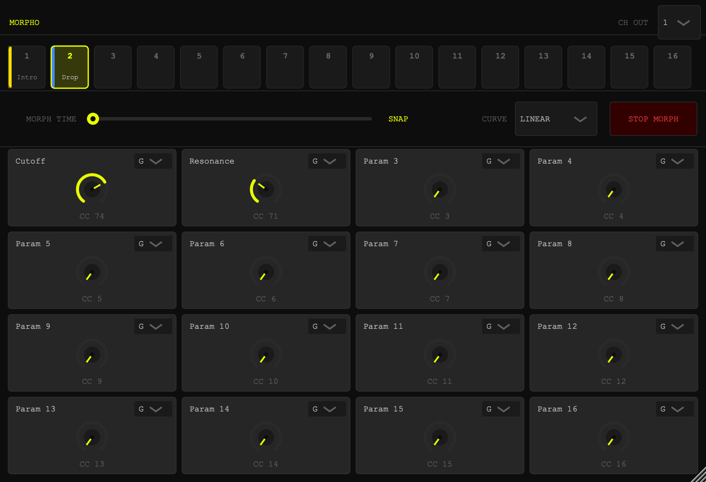

# MORPHO

Store up to 16 snapshots of 16 MIDI CC values, and glide between them.

MORPHO sends MIDI CC to whatever is listening (a hardware synth, a soft synth, an effect's
MIDI-mapped knobs). You set up 16 slots, each a CC number on a MIDI channel, turn the knobs to
a sound you like and save it as a preset. Click another preset and every CC moves to its new
value over the morph time, from an instant snap to 30 seconds, along a linear, eased or S-shaped
curve.

VST3 for macOS 12+ (Apple silicon and Intel) and 64-bit Windows 10/11. Free and open source
(GNU AGPLv3).

## Install

Download the zip for your computer from the
[latest release](../../releases/latest). Each contains the plugin and an install guide
(`README.txt`). There's nothing to compile.

**macOS:** MORPHO isn't notarised by Apple, so macOS blocks it the first time. After copying it
into `~/Library/Audio/Plug-Ins/VST3`, run this once in Terminal:

    xattr -dr com.apple.quarantine ~/Library/Audio/Plug-Ins/VST3/MORPHO.vst3

The install guide in the zip also has a way to do this without Terminal.

## Use it in Ableton Live

1. Load MORPHO on a MIDI track.
2. On your instrument's track, set **MIDI From** to the MORPHO track and choose **MORPHO** below it.
3. In MORPHO, give each slot a CC number (double-click **CC 1**) and a name (double-click the name).
   The small box on each slot picks its MIDI channel; **G** follows **CH OUT** at the top.
4. Turn the knobs (each turn sends its CC straight away), then **right-click a preset** and choose
   **Save current values here**. Right-click also renames or clears a preset.
5. Set **MORPH TIME** and **CURVE**, and **click** a preset to glide to it. **STOP MORPH** freezes
   every CC where it is.

Everything (slots, presets, morph settings) is saved with your Live set. When a set opens, MORPHO
sends its current values once, so your synth starts where you left it.

Live loads MORPHO as an audio effect with MIDI in and out; audio passes through untouched.

## Build from source

Needs CMake 3.22+ and a C++17 compiler. JUCE 8.0.4 is downloaded automatically.

    cmake -B build -DCMAKE_BUILD_TYPE=Release
    cmake --build build --config Release
    # build/MORPHO_artefacts/Release/VST3/MORPHO.vst3

Tests (headless: the morph engine, presets, session restore and the editor):

    cmake -B build-tests -DMORPHO_BUILD_TESTS=ON
    cmake --build build-tests --config Release --target MORPHO_Tests
    build-tests/MORPHO_Tests_artefacts/Release/MORPHO_Tests

## How it works

| Part | Thread | Role |
|---|---|---|
| `MorphEngine::process` | Audio | Interpolates the 16 values every 32 samples and adds a CC to the block only when a value changes. Timing follows the audio clock. |
| `MorphEngine::startMorph` | Message | Hands a morph request to the audio thread through a try-locked slot; a snap (0 ms) sends only the slots that changed. |
| `MorphoProcessor` | Message | Slots, presets and session state. State changes reach the editor on the message thread. |
| `MorphoEditor` | Message | The window; refreshes at 30 Hz while a morph runs. |

## Licence

Copyright (c) 2026 Lever Studios. GNU Affero General Public License v3.0; see [LICENSE](LICENSE).
